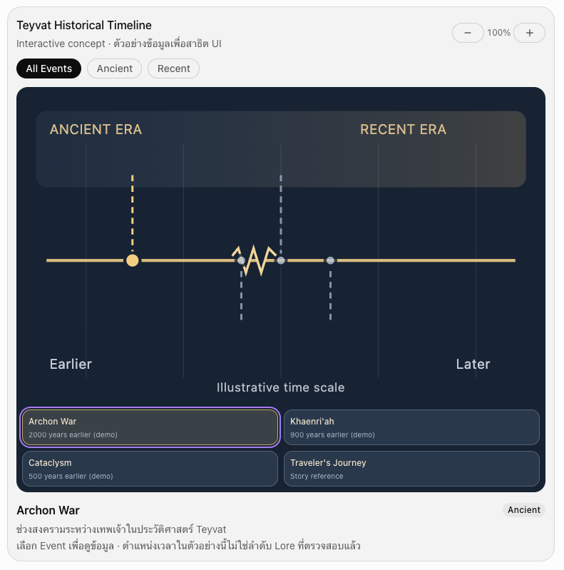
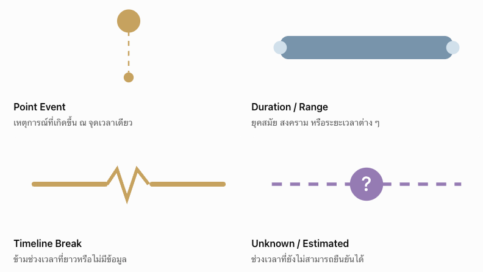
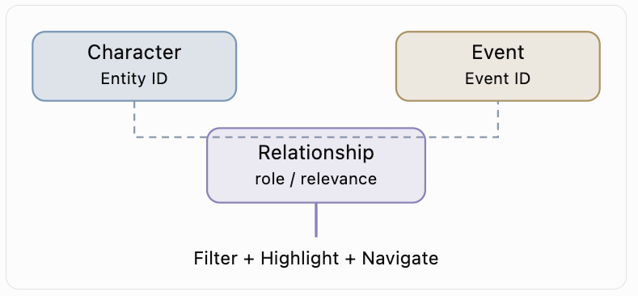

# Requirements

Genshin Impact Lore Timeline Explorer ซึ่งไม่ใช่แค่เว็บแสดงเส้นเวลา แต่เป็นระบบสำรวจประวัติศาสตร์ของ Teyvat ที่สามารถเชื่อมโยงเหตุการณ์ ตัวละคร อารยธรรม และเนื้อเรื่องเข้าด้วยกันได้

สิ่งที่ทำให้น่าสนใจกว่า Timeline ทั่วไปคือ ผู้ใช้สามารถเลือกตัวละครหนึ่งคน แล้วเห็นได้ทันทีว่าตัวละครนั้นเกี่ยวข้องกับเหตุการณ์ใดบ้าง เกิดอะไรขึ้นก่อนหรือหลัง และเหตุการณ์เหล่านั้นเชื่อมโยงกันอย่างไร

## รูปแบบเว็บไซต์ที่แนะนำ

1. Landing Page หน้าแรกแนะนำโปรเจกต์ พร้อมภาพโลก Teyvat ปุ่ม Explore Timeline และทางลัดเข้าสู่ยุคสำคัญ เช่น Ancient Civilizations หรือ Archon War
2. Public Timeline Explorer เส้นเวลาแนวนอน เลื่อนซ้ายขวา ซูมเข้าออก มี Event Card, รูปภาพ, Icon, Symbol, เส้นช่วงเวลา และรายละเอียดเมื่อคลิก
3. Character & NPC Archive ค้นหาตัวละคร ดูประวัติ ความสัมพันธ์ และกดแสดงเฉพาะเหตุการณ์ที่ตัวละครนั้นมีส่วนเกี่ยวข้อง
4. Private Back Office Dashboard สำหรับเพิ่ม แก้ไข ลบและจัดเรียงเหตุการณ์ ตัวละคร ยุคสมัย เส้นเวลา รูปภาพ และแหล่งอ้างอิง

สำหรับ Timeline หลัก มี 3 วิธีการสำรวจ โดยใช้ชุดข้อมูลเดียวกัน

- World Timeline — เห็นทุกเหตุการณ์ในประวัติศาสตร์ Teyvat ตามเวลา
- Character Timeline — กรองเหตุการณ์ที่เกี่ยวข้องกับตัวละครที่เลือก
- Era / Region Timeline — แสดงเฉพาะช่วงประวัติศาสตร์หรือภูมิภาค เช่น Khaenri'ah, Mondstadt หรือ Liyue

แต่ละหน้าควรใช้ Timeline Engine ร่วมกัน

## Tech Stack

| ส่วน            | Technology                         | เหตุผล                                  |
| --------------- | ---------------------------------- | --------------------------------------- |
| Frontend        | React + TypeScript + Vite          | เหมาะกับ Web App ที่มี Interaction เยอะ |
| Styling         | Tailwind CSS                       | จัดการธีมและ Responsive ง่าย            |
| UI Components   | shadcn/ui + Radix UI               | ทำ Modal, Dialog, Form, Select          |
| Timeline Engine | Custom SVG + HTML                  | ควบคุมเส้นและการจัดวางได้อิสระ          |
| Animation       | Motion                             | แอนิเมชัน UI และการเปลี่ยนสถานะ         |
| State           | Zustand                            | จัดการ Zoom, Filter, Selection          |
| Data Fetching   | TanStack Query                     | Cache และจัดการข้อมูล Firebase          |
| Database        | Firebase Firestore                 | NoSQL ใช้ง่าย เหมาะกับ Solo Project     |
| Authentication  | Firebase Authentication            | จำกัด BO ให้เจ้าของคนเดียว              |
| Validation      | Zod + React Hook Form              | ตรวจสอบข้อมูลใน BO                      |
| Search          | MiniSearch                         | ค้นหาข้อมูลฝั่ง Client                  |
| Hosting         | GitHub Pages หรือ Firebase Hosting | Deploy แบบ Static SPA ได้               |

ตัวเลือกหลักของผมคือ Custom SVG + HTML สำหรับ Timeline Engine เพราะ Requirement ของคุณมีทั้ง Event Card หลายรูปแบบ เส้นขาด การแบ่ง Era การเชื่อมโยงตัวละคร และการตกแต่งเส้นแบบเฉพาะเจาะจง

## Timeline Engine

ใช้ D3 Scale + D3 Zoom + SVG/HTML + Motion

ตัวอย่างโครงสร้าง Timeline



รูปแบบ Event ที่ควรรองรับ (เป็นเพียงตัวอย่าง)



## ออกแบบฐานข้อมูล Firestore

```
Firestore Collections
timelines
กำหนดเส้นเวลาหลักและเส้นเวลาย่อย

events
เหตุการณ์ วันที่ รูปแบบการแสดงผล และเนื้อหา

characters
ตัวละคร NPC และบุคคลสำคัญ

eras
ยุคสมัยและช่วงประวัติศาสตร์

regions
ภูมิภาคและสถานที่

sources
แหล่งอ้างอิงข้อมูล Lore

relationships
ความเชื่อมโยงระหว่าง Entity

settings
ตั้งค่าธีม และค่าเริ่มต้นของ Viewer
```

ตัวอย่างข้อมูล Event

```JSON
{
  "id": "cataclysm",
  "timelineIds": ["teyvat-history"],
  "title": {
    "en": "Cataclysm",
    "th": "มหาภัยพิบัติ"
  },
  "description": {
    "en": "...",
    "th": "..."
  },
  "time": {
    "type": "approximate",
    "start": -500,
    "end": null,
    "unit": "year",
    "reference": "main_story",
    "confidence": "high"
  },
  "eraIds": ["recent-history"],
  "regionIds": ["khaenriah"],
  "characterIds": ["example-character"],
  "type": "point",
  "display": {
    "variant": "image-card",
    "image": "/images/events/cataclysm.webp",
    "icon": null,
    "color": "#B8A5DD",
    "lineStyle": "dashed",
    "lane": 0
  },
  "loreStatus": "confirmed",
  "sourceIds": ["source-example"],
  "status": "published",
  "sortOrder": 10
}
```

ข้อเสนอสำคัญ: อย่าใช้ JavaScript Date เป็นชนิดข้อมูลหลักของ Timeline เพราะประวัติศาสตร์ของ Teyvat ไม่ได้ใช้ปฏิทินสากล และมีเหตุการณ์เมื่อหลายพันปีก่อน
ให้ใช้ number สำหรับแกนเวลาที่ประมาณการได้ และใช้ null สำหรับช่วงเวลาที่ยังไม่ทราบตำแหน่ง ก่อนจะนำไปแสดงผลด้วยฟังก์ชันแปลงพิกัด

## การเชื่อมโยง Character กับ Event

ภาพตัวอย่าง ไม่ใช่ระบบที่ต้องการจริง



ใช้ relationships ที่เก็บข้อมูลเพิ่ม

```TypeScript
{
  fromType: "character",
  fromId: "character-a",
  toType: "event",
  toId: "cataclysm",
  relation: "participant",
  importance: "major"
}
```

## การเก็บรูปภาพ

เก็บ 3 storage

| วิธี             | เหมาะกับ                               |
| ---------------- | -------------------------------------- |
| `public/images/` | รูป Character, Icon, Event ที่ใช้ประจำ |
| External URL     | รูปจากแหล่งที่อนุญาตให้ใช้งาน          |
| Cloud Storage    | รูปที่ Upload ผ่าน BO                  |

ผ่าน BO สามารถเลือกได้เป็นแบบไหน Cloud Storage เป็น optional

## Back Office

| เมนู              | ความสามารถ                                          |
| ----------------- | --------------------------------------------------- |
| Dashboard         | จำนวน Event, Character, Timeline, Draft             |
| Timeline Manager  | เพิ่ม Timeline, กำหนดช่วงเวลา, ตั้งค่า Lane         |
| Event Manager     | CRUD Event, รูปแบบ Card, Link ตัวละคร               |
| Character Manager | CRUD Character/NPC, ประวัติ และ Event ที่เกี่ยวข้อง |
| Era & Region      | จัดการยุคสมัยและภูมิภาค                             |
| Relationships     | จัดการความเชื่อมโยง Entity                          |
| Sources           | จัดการแหล่งอ้างอิง Lore                             |
| Media Library     | จัดการ URL และ Asset Path                           |
| Settings          | Theme, Colors, Timeline Defaults                    |

### ความสามารถที่ควรมี

1. Lore Certainty

ไม่ใช่ทุกเหตุการณ์จะมีปีที่ยืนยันชัดเจน ควรแยกความน่าเชื่อถือของข้อมูลออกจากความแม่นยำของวันที่ เช่น confirmed, inferred, theory และใช้ exact, approximate, unknown สำหรับเวลา

2. Spoiler Control

ผู้ใช้อาจเลือกได้ว่าต้องการเห็นข้อมูลถึง Archon Quest หรือ Version ใด โดยแต่ละ Event กำหนด spoilerLevel หรือ requiredQuestIds เพื่อซ่อนข้อมูลที่ยังไม่ควรเห็น

3. Focus Character

เมื่อเลือก Character แล้ว Timeline จะ Dim เหตุการณ์อื่น และ Highlight เฉพาะเหตุการณ์ที่เชื่อมโยงอยู่ สามารถกด Next / Previous เพื่อเดินตามประวัติของตัวละครได้

4. Timeline Break Manager

BO ควรกำหนดจุด Break ได้เอง เช่น ช่วงที่ไม่มีเหตุการณ์น่าสนใจเป็นเวลาหลายพันปี ให้ย่อพื้นที่ช่วงนั้นโดยยังมี Marker แสดงว่ามีช่วงเวลาที่ถูกข้ามไป

5. Source of Truth

หนึ่งเหตุการณ์อาจมีข้อมูลจาก Archon Quest, World Quest, หนังสือในเกม หรือคำพูดตัวละคร ควรผูก Source ไว้เสมอ และแยกข้อมูลที่เป็นข้อเท็จจริงจากการตีความ

## Future Feature

หลักข้อมูลครับถ้วน

| Feature                | Priority | เหตุผล                             |
| ---------------------- | -------- | ---------------------------------- |
| Zoom Levels            | P0       | ย่อเป็น Era และขยายเป็น Event      |
| Filter + Search        | P0       | หาข้อมูลและตัวละครได้ง่าย          |
| Responsive Mobile      | P0       | รองรับการสำรวจบนมือถือ             |
| Event Deep Link        | P0       | แชร์ URL ไปยังเหตุการณ์โดยตรง      |
| Auto Event Layout      | P0       | ป้องกัน Card ทับซ้อนกัน            |
| Lore Source References | P0       | ตรวจสอบที่มาของข้อมูลได้           |
| Draft / Publish        | P0       | จัดการข้อมูลก่อนเปิดเผย            |
| Lore Certainty         | P1       | แยก Canon, Estimated, Theory       |
| Relationship Explorer  | P1       | เห็นการเชื่อมโยงของเหตุการณ์       |
| Spoiler Filter         | P1       | เลือกเนื้อหาตามบทที่เล่นถึง        |
| Compare Characters     | P2       | เปรียบเทียบ Timeline ของ 2 ตัวละคร |
| Story Mode             | P2       | พาเดินชมประวัติศาสตร์ทีละเหตุการณ์ |

## Hosting และค่าใช้จ่าย

ถ้าจะ Deploy ด้วย GitHub Pages แล้วให้ BO เขียนข้อมูลไปยัง Firestore โดยตรงก็ทำได้ เพราะ Frontend เป็น Static Web App ส่วน Cloud Storage เป็น Optional

## Roadmap การพัฒนาเบื้องต้น (Draft)

แบ่งเป็น 5 Phase

Phase 1 — Foundation & Timeline Engine

    ตั้งค่า React, Firebase, Theme และสร้าง Timeline ที่มี Zoom, Pan, Event Point, Range, Break, Image Card และ Modal โดยใช้ Mock Data

Phase 2 — Database & Back Office

    Firestore Schema, Authentication, Event CRUD, Character CRUD, Era/Region, Sources, Timeline Editor และ Publish Workflow

Phase 3 — Public Explorer

    Landing Page, Search, Filters, Character Timeline, Deep Link, Responsive UI และ Lore Certainty

Phase 4 — Interaction & Polish

    Animation, Focus Mode, Relationship Highlight, Auto Layout, Performance Optimization และ Accessibility

Phase 5 — Advanced Lore Features

    Relationship Explorer, Compare Characters, Story Mode, Spoiler Controls และ Import/Export
